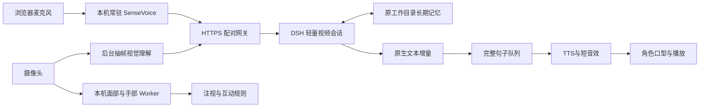

# 架构与设计

## 低延迟

识别器常驻并预热，减少模型重载。视觉分析在后台持续、单设备不重叠，观察有效期10秒；需要当前细节时仍重新取帧。手势与表情规则不逐帧调用语言模型。

主人视频会话独立于原来的大聊天，复制模型路由、挂载相同角色预设、使用原工作目录共享长期记忆。初次只带最多6条、3000字符的近期手机聊天摘录，原历史保持在原会话中。后续沿用宿主上下文整理；专用会话也会随着使用增长，并非永久固定token数。

通过宿主正式 `agent/assistant-stream` 事件获取真实 `text-delta`，只监听当前agent与当前发言。推理、工具参数、记忆整理不进入朗读。最终消息校准预览，失败重试不会把失败草稿追加为新答案。已说前缀被修改时停止旧声音。

完整第一句即可合成；后面句子按序播放并预取。断句队列过滤同一回复中的重复句子，打断后丢弃旧队列，不自动重新发问。

## 记忆

真实实时发言使用DSH用户消息来源，让meow-memory正常注入首次快照与逐轮命中；主动开场保留插件来源，避免成为假的用户事实。保留8个记忆工具及整理流程。朋友使用独立cwd，不能继承主人私聊和记忆。

## 边界

手势/面部动作驱动轻量规则，再结合对话选择回应；不会将皱眉直接等同生气。角色使用二维图集和局部眼神动画，不是用户动作的直接镜像。原始摄像头视频不由本项目持续录制；云端抽帧和宿主附件保留策略由对应服务决定。

电脑3092仅回环访问，有会话、来源检查与CSRF保护；网关3091通过一次性配对绑定服务端身份，手机固定信任证书指纹。QQ出站有固定收件人和轮次额度，手机对话不能借工具发QQ或操作电脑。
